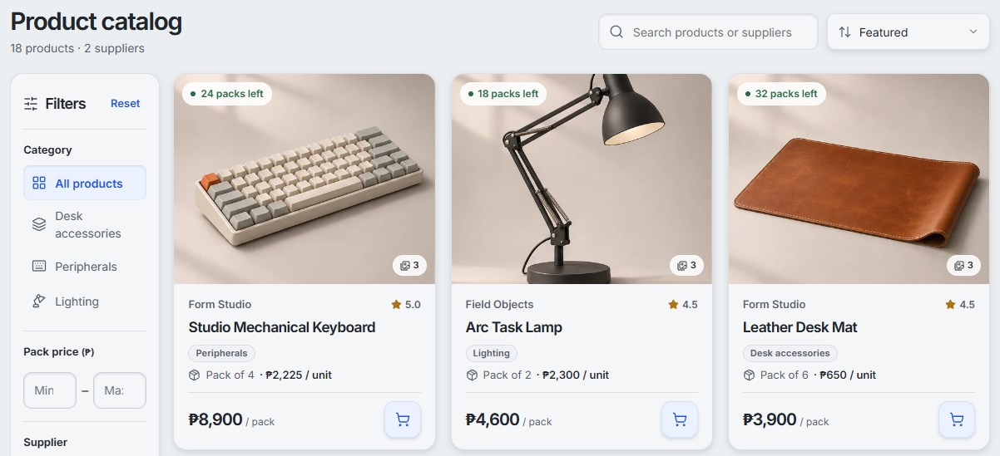

# Forma Trade

**A B2B wholesale marketplace for workspace products.** Retail buyers compare pack prices, place one purchase order across suppliers, and track each shipment. Vendors manage their own catalog, stock, fulfillment, and sales.

[](https://github.com/Gabbu69/Forma-Trade/actions/workflows/checks.yml)

[Run locally](#run-locally) · [Demo accounts](#demo-accounts) · [Defense walkthrough](#defense-walkthrough) · [Tests](#tests-and-audit-log)



## What you can do

| Buyers | Vendors |
| --- | --- |
| Filter by category, supplier, price, rating, and stock. Compare pack sizes and per-unit costs. | Manage listings, product photos, available packs, and stock alert thresholds. |
| Check out across suppliers in Philippine pesos. Track each shipment and print the purchase order. | Find orders by PO number, buyer, or status, then update fulfillment. |
| Rate completed purchases and use **Buy Again** to review current terms before reordering. | Review daily and monthly sales and export the figures as CSV. |

Both roles can edit their profile, choose a theme, and manage notifications. Generate a one-time recovery code in **Settings** while signed in and save it somewhere safe.

## Run locally

**Windows prerequisites** — PHP 8.1+ on PATH with PDO MySQL, mbstring, and GD with WebP support, plus a MariaDB distribution with the server and database initializer.

1. Double-click **start.cmd**, or run it from the project folder.

   ```powershell
   .\start.cmd
   ```

2. Open [http://127.0.0.1:8077/](http://127.0.0.1:8077/). The first launch creates `.env`, initializes the private database on loopback port 33317, and seeds the catalog. Later launches preserve your data.

The storefront, photos, and charts work offline. Press **Ctrl+C** in the launch window to stop the web server.

<details>
<summary>Custom port or existing database</summary>

To change the port and leave the browser closed, run:

```powershell
.\start.cmd -NoBrowser -Port 8080
```

Set `FORMA_MARIADB_BIN` if MariaDB is installed outside the folders the launcher searches. The default search checks Program Files and `C:\xampp`.

To use an existing MySQL 8 or MariaDB server, copy `.env.example` to `.env` and configure a dedicated UTF-8 database and app user. Grant SELECT, INSERT, UPDATE, DELETE, CREATE, ALTER, INDEX, and REFERENCES on that database. Run:

```powershell
php -d extension=pdo_mysql backend/setup.php
.\start.cmd
```

The same setup command applies additive upgrades to an existing database. Sessions created before session versioning require a fresh sign-in after the upgrade.

</details>

## Demo accounts

On the sign-in page, open **Use a demo account** and select an account. The shared local demo password is `FormaDemo24!`.

| Account | Role | Email |
| --- | --- | --- |
| North Retail | Buyer | `north@forma.test` |
| Bay Retail | Buyer | `bay@forma.test` |
| Form Studio | Vendor | `form@forma.test` |
| Field Objects | Vendor | `field@forma.test` |

## Defense walkthrough

1. **Shop as North Retail.** Filter the catalog, then add one pack each of the Studio Mechanical Keyboard and Arc Task Lamp. At seed prices the cart totals **₱13,500**.
2. **Place one PO for two suppliers.** Sign in from the cart and check out. Note the PO number and the two supplier-specific statuses.
3. **Fulfill as each vendor.** In **Orders**, search for the PO number. Mark each vendor’s portion in transit and then complete. Compare the daily or monthly chart with **Download CSV** for the same period.
4. **Return as the buyer.** Open the shipment notifications, print the PO, and rate a completed item. Use **Buy Again** on PO-1001 to see how current prices and pack sizes are reviewed.

Use the [defense checklist](docs/defense-checklist.md) for the rubric, last-pack race, and audit demonstration.

## Architecture and documentation

**PHP 8 · MariaDB/MySQL · Bootstrap 5 · Vanilla JavaScript · Chart.js**

The PHP front controller applies session, role, and CSRF checks. PDO prepared statements and InnoDB transactions keep checkout, stock deductions, and supplier records consistent. Fetch updates the catalog, cart, order statuses, and charts during use.

| Reference | What it covers |
| --- | --- |
| [Requirements](docs/requirements.md) | Workflows, business rules, and acceptance conditions |
| [Data model and ER diagram](docs/data-model.md) | Accounts, catalog, orders, notifications, and audit records |
| [API reference](docs/api.md) | Routes, roles, payloads, and responses |
| [SQL schema](backend/config/schema.sql) and [demo seed](database_seed.sql) | Tables, constraints, and sample records |

Local credentials, databases, and QA screenshots are excluded from Git. The demo bundles 18 product galleries and the libraries it needs to run offline.

## Tests and audit log

Start the local database first. **Python 3.10+** runs the API acceptance suite against an isolated test database.

```powershell
python tests/acceptance.py
```

For the browser walkthrough, install Node.js and Microsoft Edge, then install Playwright in the ignored runtime folder.

```powershell
npm install --prefix .runtime/browser playwright
$env:NODE_PATH = (Resolve-Path .runtime/browser/node_modules).Path
python tests/acceptance.py --browser
```

Use `$env:FORMA_BROWSER = "chrome"` for installed Chrome. The suite checks 375, 768, and 1440 px viewports and saves screenshots in `.runtime/qa`. GitHub Actions runs syntax checks and the API suite on both MySQL 8.0 and MariaDB 10.11 for pull requests and pushes to `main`.

View the latest 50 local security events with:

```powershell
php -d extension=pdo_mysql backend/audit.php
```

The audit records include the action, outcome, timestamp, and account when known. Passwords and recovery codes are excluded. Authentication rate limits return HTTP 429 with a retry time.
