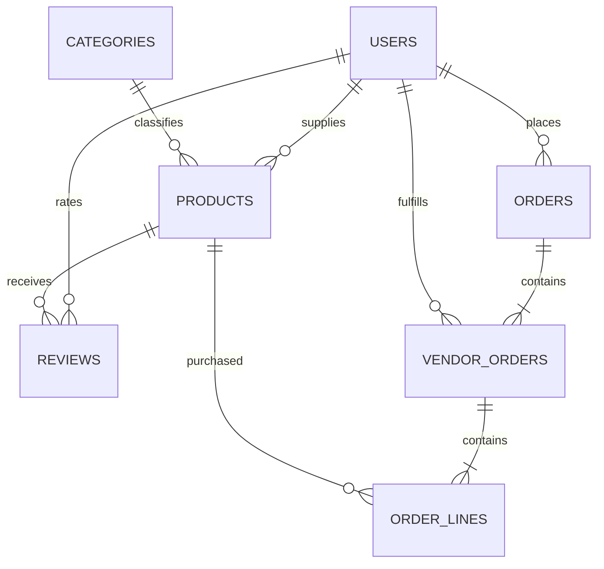

# Relational model

| Table | Key | Responsibility |
| --- | --- | --- |
| users | id, unique email | Buyer or supplier identity, role, bcrypt hash |
| categories | id, unique name | Reusable product categories |
| products | id | Supplier, category, pack terms, price, stock, alert threshold, edit version |
| reviews | product_id + buyer_id | One rating per buyer and product |
| orders | id, unique buyer_id + request_key | Buyer, purchase timestamp, replay identity |
| vendor_orders | id, unique order_id + vendor_id | Supplier-specific fulfillment and completion time |
| order_lines | id, unique vendor_order_id + product_id | Ordered packs and purchase-time terms |

Foreign keys enforce references between entities. Each relation stores attributes of its own key. A supplier name and category name appear once in their respective master tables. Product scores, cart totals, order totals, and sales are derived. A purchase line's historical title, price, and pack size describe the transaction at purchase time and can differ from the current catalog.

InnoDB indexes cover catalog category and price, buyer history, per-vendor status and completion time, and all foreign keys. The exact types, indexes, and constraints are in [the schema](../backend/config/schema.sql). Quantities are measured in packs. Line items preserve the number of units per pack to keep order history meaningful.
